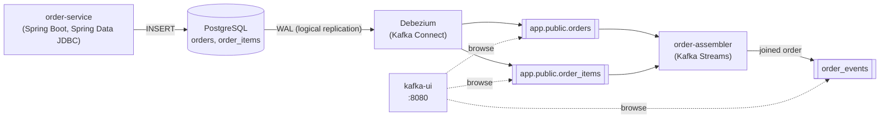
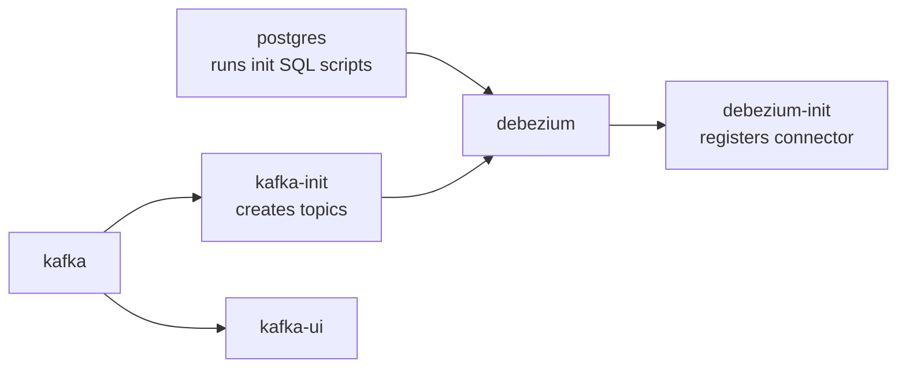
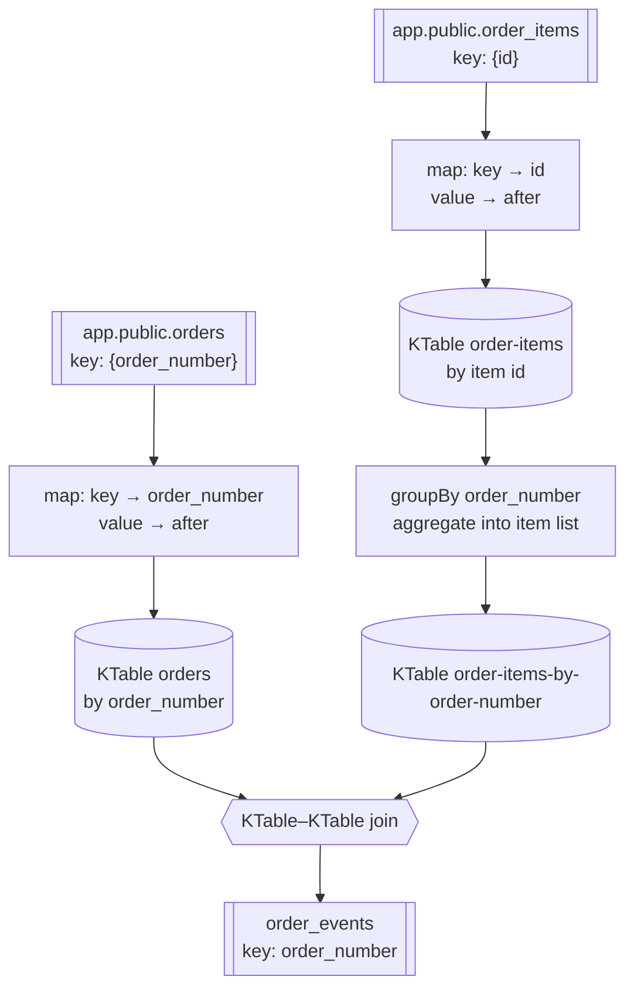

# Data Liberation with Debezium

A small, end-to-end example of the **data liberation** pattern: an application writes orders to its own
PostgreSQL database as usual, **Debezium** captures every row change from the write-ahead log and publishes it to
Kafka, and a **Kafka Streams** application joins the separate `orders` and `order_items` change streams into
complete, self-contained order events.

The writing application knows nothing about Kafka. The events are derived from the database, not dual-written.

## Architecture



| Component         | Role                                                                                                 |
|-------------------|------------------------------------------------------------------------------------------------------|
| `order-service`   | Generates random orders and stores them in PostgreSQL (one row in `orders`, 1–3 rows in `order_items`). |
| PostgreSQL        | Source database, started with `wal_level=logical` so Debezium can read the change log.               |
| Debezium          | PostgreSQL source connector running in Kafka Connect; publishes one topic per table.                 |
| `order-assembler` | Kafka Streams app that joins orders with their items and publishes complete orders to `order_events`. |
| kafka-ui          | Web UI for browsing topics, messages, consumer groups and the Debezium connector.                    |

## Prerequisites

- Docker with Docker Compose
- JDK 25 (the Gradle wrapper downloads Gradle itself)

## Quick start

### 1. Start the infrastructure

```shell
docker compose up -d
```

This starts PostgreSQL, Kafka, Debezium and kafka-ui, plus two one-shot init containers:



- `docker/postgres/01-schema.sql` creates the tables and `docker/postgres/02-sample-data.sql` loads 20 sample
  orders. They run only when the `postgres-data` volume is empty, i.e. on the very first start.
- `kafka-init` runs `docker/kafka/create-topics.sh`, which creates the topics with 3 partitions.
- `debezium-init` registers the connector from `docker/debezium/postgres-connector.json`. With
  `snapshot.mode: initial` Debezium first publishes the existing rows, then streams new changes.

Check that the connector is running:

```shell
curl -s localhost:8083/connectors/postgres-connector/status
```

| Service       | Address                              |
|---------------|--------------------------------------|
| PostgreSQL    | `localhost:5432` (db/user/password: `app`) |
| Kafka         | `localhost:9092` (from host), `kafka:29092` (from containers) |
| Kafka Connect | http://localhost:8083                |
| kafka-ui      | http://localhost:8080                |

### 2. Start the order assembler

```shell
./gradlew :order-assembler:bootRun
```

It immediately processes the snapshot of the sample orders and publishes them to `order_events`.

### 3. Generate orders

In another terminal:

```shell
./gradlew :order-service:bootRun
```

`order-service` creates a random order every second (see `order-generator.*` in
`order-service/src/main/resources/application.yaml`). Press **ENTER** to stop generating and exit.

### 4. Watch the events

Open kafka-ui at http://localhost:8080 and go to **Topics → order_events → Messages**, or use the console consumer:

```shell
docker compose exec kafka /opt/kafka/bin/kafka-console-consumer.sh \
  --bootstrap-server localhost:29092 --topic order_events --from-beginning \
  --formatter-property print.key=true
```

Changes made directly in the database are picked up too:

```shell
docker compose exec postgres psql -U app -d app \
  -c "UPDATE orders SET status = 'SHIPPED' WHERE order_number = '50035603-ad04-466f-9665-aa77e092a300'"
```

## Topics

| Topic                    | Producer        | Key                    | Value                                  |
|--------------------------|-----------------|------------------------|----------------------------------------|
| `app.public.orders`      | Debezium        | `{"order_number": …}`  | Debezium change event for `orders`     |
| `app.public.order_items` | Debezium        | `{"id": …}`            | Debezium change event for `order_items` |
| `order_events`           | order-assembler | order number (string)  | Complete order with items              |

Debezium topic names follow `<topic.prefix>.<schema>.<table>`. Kafka Streams also creates its own internal
`order-assembler-*-repartition` and `order-assembler-*-changelog` topics.

### Debezium change event

Values are plain JSON (no embedded schema). `op` is `r` (snapshot read), `c` (insert), `u` (update) or `d`
(delete); a delete is followed by a tombstone (`null` value). `decimal.handling.mode: string` makes `NUMERIC`
columns readable strings instead of base64-encoded bytes.

```json
{
  "before": null,
  "after": {
    "id": "d8ab357f-59c4-4c28-8cb7-44a7b41b4511",
    "order_number": "12b5a509-b7cf-44fd-8a63-95e26c302099",
    "item_name": "Wireless Mouse",
    "quantity": 1,
    "unit_price": "24.99"
  },
  "source": { "connector": "postgresql", "schema": "public", "table": "order_items", "lsn": 26385968, "...": "..." },
  "op": "r",
  "ts_ms": 1792945886838
}
```

### Order event

```json
{
  "orderNumber": "50035603-ad04-466f-9665-aa77e092a300",
  "customerId": "08274926-7e8c-4d91-9ecb-ec11f3565e9d",
  "status": "DELIVERED",
  "createdAt": "2026-09-02T11:42:00Z",
  "items": [
    { "id": "ace1e678-ada6-483d-af45-72e96f4e176a", "itemName": "Mechanical Keyboard", "quantity": 1, "unitPrice": 89.90 },
    { "id": "b644c335-b744-478e-b80a-2e7a779f2a54", "itemName": "USB-C Cable", "quantity": 2, "unitPrice": 9.99 },
    { "id": "29eb1ab5-13c0-44c7-93e0-4a349944f8e4", "itemName": "Mouse Pad", "quantity": 1, "unitPrice": 12.50 }
  ]
}
```

When an order is deleted, a tombstone is published for its key.

## How the assembler works

`order-assembler/src/main/java/pl/dworski/orderassembler/topology/OrderEventsTopology.java`



1. Each Debezium topic is read as a stream; only the `after` state of the row is kept, so deletes and tombstones
   become `null` and remove the row from the table.
2. Items are re-grouped by `order_number` into a list. The aggregate adds, replaces and removes items as they are
   inserted, updated or deleted.
3. The orders table is joined with the item lists. Both sides are re-keyed by `order_number` first, so they are
   co-partitioned.

This is a table–table join, so it needs no window: the latest state of every order and item list is kept in a
state store, and a change on either side, however late, re-emits the updated order.

### Things to know

- **Intermediate results.** An order and its items arrive as separate events on separate topics, so an order may
  first be emitted with only some of its items. The Kafka Streams record cache hides some of these, but not all.
  For strict completeness, Debezium transaction metadata (`provide.transaction.metadata`) can be used to emit an
  order only once its whole transaction is assembled.
- **State.** The local state lives in RocksDB under `/tmp/kafka-streams/order-assembler` and is backed by
  changelog topics in Kafka, from which it is rebuilt if the local directory is lost.
- **Topics are not created by the app.** They come from `docker/kafka/create-topics.sh`; run it first when using a
  different Kafka cluster, otherwise Kafka Streams cannot find its source topics.

## Project layout

```
.
├── docker-compose.yml
├── docker
│   ├── postgres/01-schema.sql           # schema (also used by order-service tests)
│   ├── postgres/02-sample-data.sql      # sample data
│   ├── kafka/create-topics.sh           # topic creation (3 partitions)
│   └── debezium/postgres-connector.json # Debezium connector config
├── order-service                        # writes orders to PostgreSQL
└── order-assembler                      # Kafka Streams join → order_events
```

## Tests

```shell
./gradlew test
```

`order-service` repository tests start PostgreSQL with Testcontainers, so Docker must be running.
`order-assembler` topology tests use `TopologyTestDriver` and need no broker.

## Resetting

Remove all containers and data (database, topics, consumer offsets) and the local Kafka Streams state:

```shell
docker compose down -v
rm -rf /tmp/kafka-streams/order-assembler
```

The next `docker compose up -d` starts from a fresh database with the sample data.
